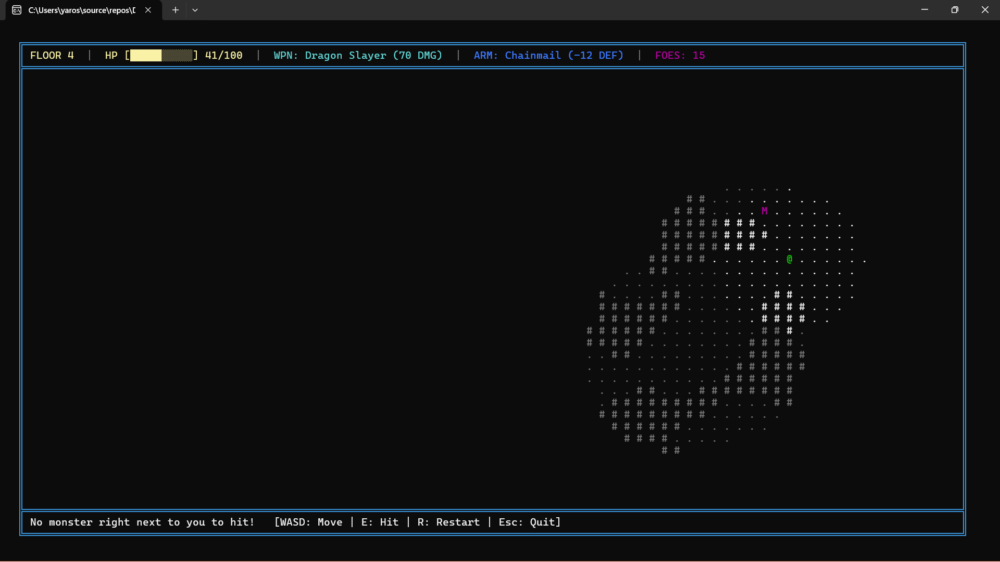

# ⚔️ DAngeon

A procedural terminal roguelike dungeon crawler built in pure **C# / .NET** with zero external game engines or third-party dependencies.



## ✨ Features

* **Procedural Cave Generation:** Uses a 4-pass **Cellular Automata** algorithm (4–5 rule with double buffering) to generate organic cave layouts that dynamically scale to fit your terminal window.
* **Two-Layer Fog of War:** Tracks explored tiles in memory (`DarkGray`) while dynamically revealing line-of-sight radius (`White`) and hiding enemies once they leave your field of view.
* **Flicker-Free Console Rendering:** Batches consecutive same-colored tile runs into a `StringBuilder` buffer with `Console.SetCursorPosition` to eliminate cursor jumping and screen tearing.
* **Tactical Turn-Based Combat:**
  * **Stamina System:** Enemies act every second turn, allowing you to kite or outmaneuver packs in narrow corridors.
  * **Dodge Phase (`[DODGE READY!]`):** Taking damage grants a 1-turn dodge window, letting you slip right past an enemy blocking a doorway or corner.
* **Infinite Floor Progression:** Descend deeper through floors (`E`) with scaling enemy stats and tiered equipment drops—from a *Rusty Dagger* (`20 DMG`) up to the *Dragon Slayer* (`70 DMG`).

## 🕹️ Controls & Legend

### Controls
| Key | Action |
| :--- | :--- |
| `W` `A` `S` `D` / `Arrows` | Move or slip past an enemy when `[DODGE READY!]` is active |
| `E` / `Space` | Attack an adjacent enemy (melee) |
| `R` | Resize map to current window and start a new run |
| `Esc` | Quit game |

### Map Symbols
| Symbol | Entity | Description |
| :---: | :--- | :--- |
| `@` | **Player** | You (turns yellow when Dodge Phase is active) |
| `M` | **Monster** | Hostile creature (4-directional movement, scales per floor) |
| `†` | **Weapon** | Swords & daggers that upgrade your attack damage |
| `A` | **Armor** | Protective gear that reduces incoming damage |
| `+` | **Healing Potion** | Restores `+35 HP` (up to `100 HP` max) |
| `E` | **Exit** | Stairs leading down to the next floor |
| `#` / `.` | **Wall / Floor** | Procedural cave terrain |

## 🚀 Getting Started

### Run from Source
Make sure you have the [.NET SDK](https://dotnet.microsoft.com/download) installed:

```bash
git clone https://github.com/<Yas1a-h>/DAngeon.git
cd DAngeon
dotnet run
```

> **Tip:** Maximize your terminal window (`Alt + Enter` in Windows Terminal) and press `R` to generate a full-screen dungeon.

### Build Standalone `.exe` (Windows)
To package the game into a single self-contained executable that runs without requiring .NET on the target machine:

```bash
dotnet publish -c Release -r win-x64 --self-contained true -p:PublishSingleFile=true
```

The executable will be generated in `bin/Release/net*/win-x64/publish/DAngeon.exe`.

## 🛠️ Tech Stack & C# Highlights

* **Language:** C# (Top-level statements, `record` types with `with`-expressions, `switch` pattern matching with `when` guards, `ValueTuple` coordinates, `StringBuilder` render batching).
* **Runtime:** .NET Console Application (`UTF-8` box-drawing & symbol rendering).